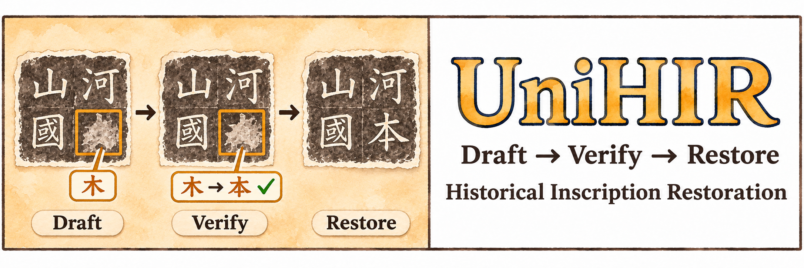
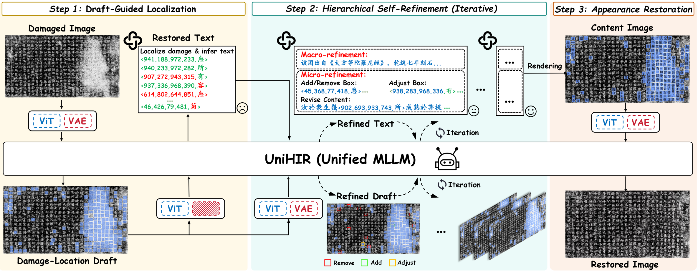
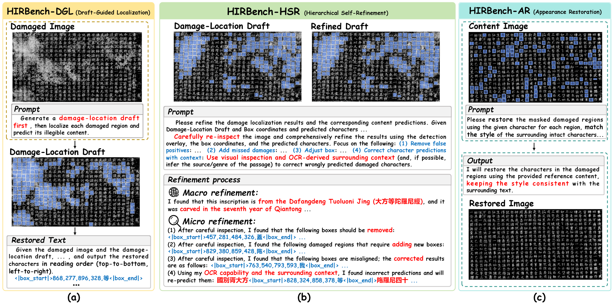
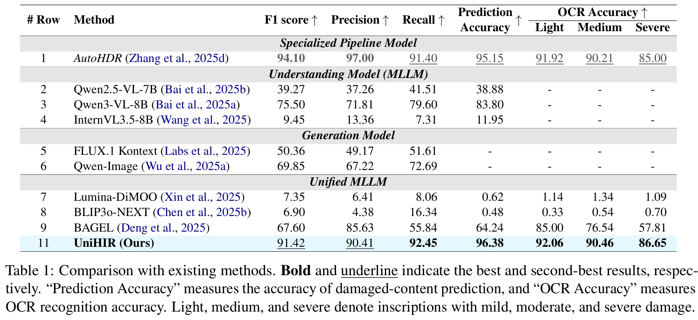
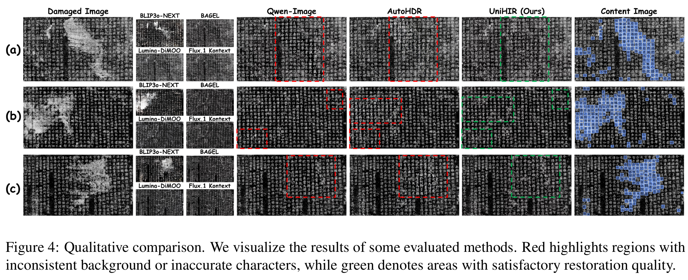

<div align="center">

# UniHIR

### Draft, Verify, Restore: Self-Refining Historical Inscription Restoration with a Unified MLLM

[**English**](README.md) | [**简体中文**](README_CN.md)

[](https://aclanthology.org/2026.acl-long.1254/)
[](https://aclanthology.org/2026.acl-long.1254/)
[](https://www.modelscope.cn/models/zzxfzyy/UniHIR)
[](https://www.python.org/)
[](https://creativecommons.org/licenses/by-nc-nd/4.0/)
[](https://github.com/ZZXF11/UniHIR)

**Yuyi Zhang<sup>&#42;</sup> · Junle Liu<sup>&#42;</sup> · Peirong Zhang<sup>&#42;</sup> · Jianliang Liu · Zhenhua Yang · Lianwen Jin<sup>†</sup>**

South China University of Technology · Deep Learning and Vision Computing Lab

<sup>&#42;</sup> Equal contribution &nbsp;&nbsp; <sup>†</sup> Corresponding author

</div>

> **UniHIR is the first unified multimodal large language model for end-to-end historical inscription restoration.** It drafts damage locations and illegible content, verifies and refines its own predictions, and restores the full-page appearance in one unified framework.

## 🔥 News

- **2026-07-05** — The paper is published at **ACL 2026 Main**. [[Paper](https://aclanthology.org/2026.acl-long.1254/)] [[PDF](https://aclanthology.org/2026.acl-long.1254.pdf)]
- **2026-07-05** — Inference code and pretrained UniHIR weights are released.

## ✨ Overview

<p align="center">
  
</p>

UniHIR replaces task-separated restoration pipelines with a single model that performs three connected stages:

1. **Draft-Guided Localization** — jointly localizes damaged regions and predicts illegible characters.
2. **Hierarchical Self-Refinement** — repeatedly corrects missing, redundant, misaligned, or semantically inconsistent predictions at both macro and micro levels.
3. **Appearance Restoration** — renders the refined content back into the document while preserving page-level typography and style.

### Key contributions

- A unified MLLM formulation for end-to-end Historical Inscription Restoration (HIR).
- Draft-Guided Localization and Hierarchical Self-Refinement for iterative reasoning and self-correction.
- **UHIRFactory**, a step-wise, memory-efficient instruction-tuning strategy for high-resolution inputs and long sequences.
- **HIRBench**, covering damage localization, hierarchical refinement, and appearance restoration.
- Strong restoration accuracy and visual quality without sacrificing full-page consistency.

## 📦 Resources

| Resource | Link | Status |
|---|---|---|
| Paper | [ACL Anthology](https://aclanthology.org/2026.acl-long.1254/) · [PDF](https://aclanthology.org/2026.acl-long.1254.pdf) | Available |
| Pretrained UniHIR | [ModelScope](https://www.modelscope.cn/models/zzxfzyy/UniHIR) | Available |
| Inference code | [`infer.py`](./infer.py) | Available |
| HIRBench | 👉 [Apply Here](http://121.41.49.212:9000/) | Available upon application |

## 🚀 Quick Start

### 1. Clone the repository

```bash
git clone https://github.com/ZZXF11/UniHIR.git
cd UniHIR
```

### 2. Create the environment

```bash
conda create -n unihir python=3.10 -y
conda activate unihir
pip install -r requirements.txt
```

### 3. Download the pretrained model

Download the weights from [ModelScope](https://www.modelscope.cn/models/zzxfzyy/UniHIR) and place the model directory at `./UniHIR`, or provide its location through `--model_path`.

### 4. Run inference

```bash
CUDA_VISIBLE_DEVICES=0 python infer.py \
  --img_path examples/FS_12_159_2.jpg \
  --ref_count 6 \
  --save_path ./results \
  --model_path ./UniHIR
```

The command saves two files in `./results`:

- the restored image, using the original input filename;
- a text file containing the intermediate and merged restoration predictions.

> [!NOTE]
> We recommend an NVIDIA A100-class GPU with **80 GB VRAM** for inference. Memory requirements may vary with image resolution and the number of refinement iterations.

### Command-line arguments

| Argument | Default | Description |
|---|---:|---|
| `--img_path` | `examples/FS_12_159_2.jpg` | Input damaged historical inscription image |
| `--ref_count` | `6` | Number of hierarchical refinement iterations |
| `--save_path` | `./results` | Directory for restored images and text predictions |
| `--model_path` | `./UniHIR` | Local path to the pretrained UniHIR model |

## 🧩 HIRBench

<p align="center">
  
</p>

HIRBench includes three subsets: HIRBench-DGL for draft-guided localization, HIRBench-HSR for hierarchical self-refinement, and HIRBench-AR for appearance restoration.

### Dataset Access and Responsible Use

The original data come from public sources, and copyright remains with the original providers. The curated and annotated HIRBench dataset is available exclusively for non-commercial research and is licensed to universities and research institutions.

- Submit a signed application through the lab’s online platform. Applicants must be full-time employees of a university or research institute. An official institutional seal is recommended to facilitate review, and a departmental seal is acceptable. 👉 [Apply Here](http://121.41.49.212:9000/)
- List or attach one or two papers published within the past six years that show your or your team’s work on OCR, historical document analysis and restoration, document image processing, or a related area.
- After your application is approved, we will provide the dataset download link.
- All users must follow the dataset usage conditions. Authorization will be revoked if these conditions are violated.

<details>
<summary><strong>Dataset structure and sample format</strong></summary>

The dataset is available as unpacked folders or ZIP archives. Choose either format and keep all files under the same `HIRBench/` root. If downloading archives, use the files below and download `dataset_info.json` separately.

| Subset | Annotation archive | Image archives |
|---|---|---|
| DGL | `HIRBench-DGL.zip` | `images-DGL.zip` |
| HSR | `HIRBench-HSR.zip` | `images-HSR-targets.zip` and all six parts of `images-HSR-inputs.zip.001`–`.006` |
| AR | `HIRBench-AR.zip` | All three parts of `images-AR.zip.001`–`.003` |

Keep all parts of each split archive together and extract starting from `.001`. The resulting layout is:

```text
HIRBench/
├── dataset_info.json
├── HIRBench-DGL/{real,syn}/         # Annotation JSON files
├── HIRBench-HSR/                   # Annotation JSON files
├── HIRBench-AR/{real,syn,inscription_synthesis}/
└── images/
    ├── DGL/{real,syn}/{inputs,targets}/
    ├── HSR/{inputs,targets}/
    ├── AR/{real,syn}/{inputs,drafts,targets}/
    └── AR/inscription_synthesis/{drafts,targets}/
```

Braces indicate separate directories. Each UTF-8 JSON file is one sample. `conversations` contains messages with `from` (`human` for the instruction and `gpt` for the supervised response) and `value` (the message text). `images` lists image paths **relative to the JSON file’s directory**.

DGL and HSR box coordinates are normalized to 0–1000 and marked as `<|box_start|>x1,y1,x2,y2,character<|box_end|>`.

> **AR training note**. The training code loads images into three slots. Both input slots use the second image in the JSON `images` list (the character draft). The third slot uses the third image as the restoration target. The first image in the list is provided for reference only.

</details>

## 📊 Results

### Quantitative comparison

<p align="center">
  
</p>

### Qualitative comparison

<p align="center">
  
</p>

## 🗺️ Roadmap

- [x] Release inference code
- [x] Release pretrained UniHIR model
- [x] Release HIRBench

## 💙 Acknowledgements

- [BAGEL](https://github.com/bytedance-seed/BAGEL)
- [AutoHDR](https://github.com/SCUT-DLVCLab/AutoHDR)
- [DiffHDR](https://github.com/yeungchenwa/HDR)
- [HisDoc1B](https://github.com/SCUT-DLVCLab/HisDoc1B)
- [MegaHan97K](https://github.com/SCUT-DLVCLab/MegaHan97K)

## 📜 License and Copyright

The code and dataset are provided under [CC BY-NC-ND 4.0](https://creativecommons.org/licenses/by-nc-nd/4.0/) for non-commercial research. For commercial use, please contact Prof. Lianwen Jin at `eelwjin@scut.edu.cn`.

Copyright © 2026 [Deep Learning and Vision Computing Lab](http://www.dlvc-lab.net), South China University of Technology.

## ✒️ Citation

If UniHIR is useful in your research, please cite the ACL 2026 paper:

```bibtex
@inproceedings{zhang-etal-2026-draft,
  title     = {Draft, Verify, Restore: Self-Refining Historical Inscription Restoration with a Unified MLLM},
  author    = {Zhang, Yuyi and Liu, Junle and Zhang, Peirong and Liu, Jianliang and Yang, Zhenhua and Jin, Lianwen},
  booktitle = {Proceedings of the 64th Annual Meeting of the Association for Computational Linguistics (Volume 1: Long Papers)},
  month     = jul,
  year      = {2026},
  address   = {San Diego, California, United States},
  publisher = {Association for Computational Linguistics},
  url       = {https://aclanthology.org/2026.acl-long.1254/},
  doi       = {10.18653/v1/2026.acl-long.1254},
  pages     = {27216--27231}
}
```
